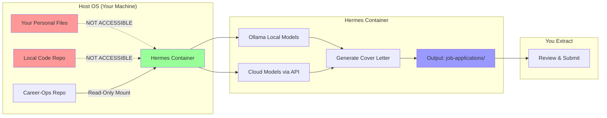
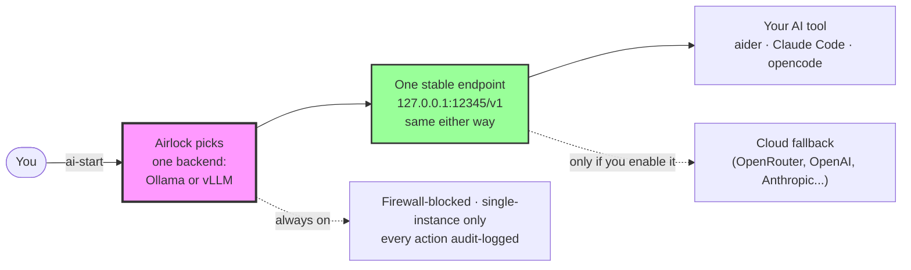
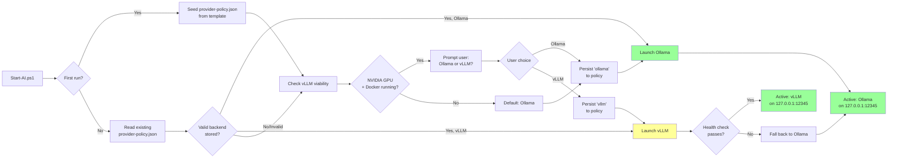
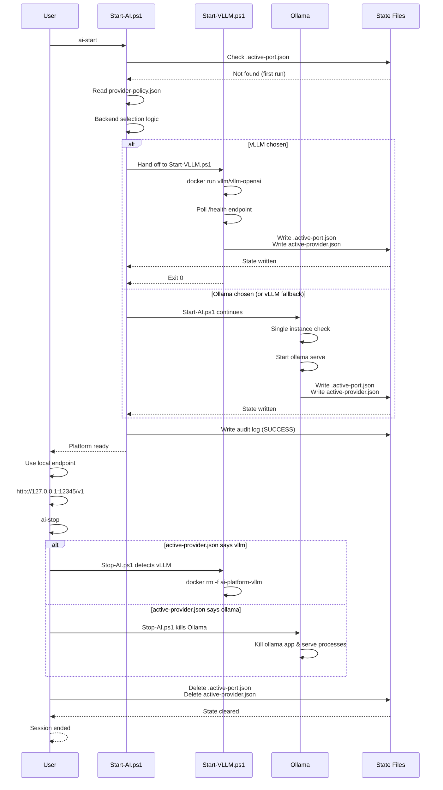
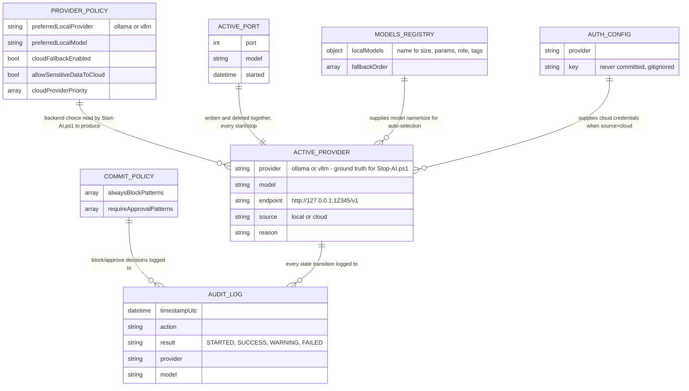
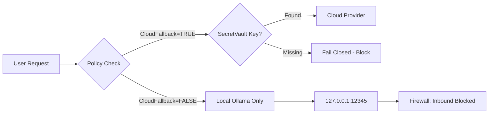

# Airlock

**A hardened, single-instance local AI platform for Windows.** Any PC — not just one specific ThinkPad. Inspect *this* machine, pull an open-weight model that actually fits it, and if you want coding, prove tool-calling **on this machine** before you trust it.

Two doors. One at a time. Not GLM, not Grok, not cloud Qwen.

- **`ai-start`** — chat, sized for *this* PC (Ollama or vLLM on port 12345). Talk. Don't expect bash/read/write loops.
- **`ai-agent-start`** — the coding door. Sizes Unsloth Dynamic 3.0 (Qwen3.8-27B GGUF) to *this* machine's free VRAM, starts llama-server, then a live Pi 3/3. First run needs no `-Profile`. A 3/3 on someone else's box is not your certificate.

On a 16 GB NVIDIA-class card the coding quant is **UD-Q3_K_XL**, and that is the only quant that may inherit the recorded 3/3. Smaller free-VRAM steps down the Unsloth ladder (`UD-IQ3_XXS`, `UD-Q2_K_XL`). Larger free-VRAM steps up (`UD-Q4_K_XL` around 22 GiB free, then Q5, Q6, Q8) — those are **candidate-only** and do not inherit the 3/3. An AMD card that fits Q3 is still a candidate. If VRAM is too small but system RAM can hold the GGUF, we mmap it on CPU (`--n-gpu-layers 0`): slow (often 1–5 tok/s), still llama-server + Pi, live contract on this PC. Tiny RAM still refuses.

One local backend at a time, walled off from the outside, everything logged.

[](LICENSE)
[](https://github.com/PowerShell/PowerShell)
[](https://ollama.ai)
[](CHANGELOG.md)
[](https://github.com/veeresh-bikkaneti/airlock/actions/workflows/ci.yml)

See [`CHANGELOG.md`](CHANGELOG.md) for what's new in each release.

---

## Why Airlock Exists

You've probably hit these problems:

| Problem | What Happens |
|---------|--------------|
| Multiple Ollama instances on different ports | Tools fail, models load multiple times into VRAM, confusion |
| No single source of truth for port/model | Manual environment variable juggling, session state lost |
| Ollama binds to `0.0.0.0` by default | Unintended network access to your local LLM |
| No audit trail for AI-assisted development | Can't trace which model generated which code |
| Cloud fallback is opaque | Accidental data leakage to external providers |
| Models fail to load due to memory pressure | Wasted time debugging "out of VRAM" errors |

Airlock fixes all of this:

✅ **Two doors, one at a time** — `ai-start` is chat sized for this PC; `ai-agent-start` is llama-server coding sized to *this* machine's free VRAM, then a live Pi 3/3. Not the same process, not the same verdict, not another PC's certificate.

✅ **Automatic firewall guard** — inbound traffic blocked by default

✅ **Structured audit logging** — every API call logged with model/provider metadata

✅ **Resource monitoring** — RAM/VRAM checks before model load

✅ **Policy-driven cloud fallback** — explicit approval required, secrets never in code

✅ **Unified CLI** — `ai-start` (chat), `ai-agent-start` (coding), `ai-stop`, `ai-health`

---

## Quick Start

### Prerequisites
- Windows 11
- PowerShell 7+ (auto-installed via winget by `install.ps1` when missing)
- Ollama (auto-installed on first `ai-start` via winget when missing; must not already be running)
- Python 3.11+ (for aider)
- Git (auto-installed via winget by `install.ps1` when missing)

### Installation (1-line)

```powershell
irm https://raw.githubusercontent.com/veeresh-bikkaneti/airlock/main/install.ps1 | iex
```

This clones the repo to `~/.airlock-src` and runs `setup.ps1`, which copies scripts/config to `~/.ai-platform` and wires `profile-helpers.ps1` into your PowerShell profile. Restart PowerShell (or run `. $PROFILE`) afterward so the `ai-*` commands are available.

> Like any `irm | iex` one-liner (rustup, Scoop, oh-my-posh use the same pattern), this runs code before you've read it — that's the convenience trade-off. If you'd rather review first, clone and inspect, then run `setup.ps1` yourself:
> ```powershell
> git clone https://github.com/veeresh-bikkaneti/airlock.git
> cd airlock
> .\setup.ps1
> ```

`ollama pull <model>` isn't a required manual step — `ai-start` auto-detects your hardware and pulls the best-fitting model in the background the first time you run it. Pull one yourself first only if you want a specific model pinned via `ai-start -Model <name>`.

### First Run

Two doors. `ai-start` is chat sized for *this* PC (Ollama or vLLM). `ai-agent-start` is the coding door (ADR-016): no `-Profile` sizes Unsloth Dynamic 3.0 to *this* machine's free VRAM, then a live Pi 3/3. Do not inherit another PC's certificate.

```powershell
# Coding door — sizes Unsloth to THIS PC, then a live Pi 3/3. Not GLM/Grok/cloud Qwen.
ai-agent-start -DownloadConfirmed

# Chat door (single-instance, hardened) — not the coding agent
ai-start

# Expected output:
# ========================================
#   AI PLATFORM READY (Hardened)
#   Endpoint: http://127.0.0.1:12345/v1
#   Model   : devstral-small-2:24b
#   Bind    : 127.0.0.1 ONLY (no external)
#   Firewall: Inbound port 12345 BLOCKED
# ========================================
# Note: the Firewall line is conditional on admin privileges. Running as admin,
# you'll see "Inbound port 12345 BLOCKED" (shown above). Without admin, you'll
# see "NO RULE on port 12345 (defense-in-depth only — listener is loopback-only,
# not externally reachable either way)" instead — the rule just didn't get created,
# but nothing outside your machine could reach the port regardless.

# Check health
ai-health

# aider against the chat endpoint (not a bash/read/write agent — that's ai-agent-start)
ai-code
```

---

## The Two Doors

| Door | Command | Purpose | Model Selection |
|------|---------|---------|-----------------|
| **Chat** | `ai-start` | Sized for this PC, single-instance Ollama/vLLM, firewall-guarded | Auto-picks best fit for VRAM |
| **Coding** | `ai-agent-start` | Sizes Unsloth Dynamic 3.0 to free VRAM → llama-server → live Pi 3/3 | Hardware-sized Unsloth quant |

**Key distinction:** The chat door picks models by size/install-state. The coding door *proves* tool-calling works on your hardware before giving you a certificate.

---

## Commands Reference

`ai-start` is chat sized for this PC. `ai-agent-start` is the coding door (ADR-016): Unsloth Dynamic 3.0 sized to *this* machine, then a live Pi 3/3. Not GLM/Grok/cloud Qwen.

| Command | Description |
|---------|-------------|
| `ai-start [-Model <name>] [-Backend ollama\|vllm] [-Force]` | **Chat door.** Start Ollama or vLLM, kill any rogues. `-Backend` overrides/persists the saved backend choice. Does not certify tool-calling. |
| `ai-agent-start [-Profile <id>] [-WhatIf] [-ForceVerify] [-DownloadConfirmed]` | **Coding door.** No `-Profile` sizes Unsloth Dynamic 3.0 to *this* PC (VRAM first; RAM mmap if the GPU is too small). Starts llama-server, acquires the GGUF, runs the live Pi contract, publishes `active-agent.json` only on pass. Explicit `-Profile` still supported — that is not auto-select of installed-but-unrequested (ADR-012). `-WhatIf` dry-run; `-ForceVerify` re-runs the live contract (no cache); `-DownloadConfirmed` is the recorded yes for the GGUF. |
| `ai-opencode [-Profile <id>] [-WhatIf] [-ForceVerify] [-DownloadConfirmed]` | **Coding door (opencode harness).** Same as `ai-agent-start` but targets opencode instead of pi-worker. |
| `ai-setup` | **Interactive setup.** Multi-select menu to configure which harnesses to enable (Pi, opencode, aider, memory-service, tool-proxy, Hermes). |
| `ai-stop [-CleanFirewall]` | Stop the active backend, clear state and any `ai-claude-on` redirect |
| `ai-health` | Full health check (processes, API, firewall, resources) |
| `ai-doctor` | Find dead `ANTHROPIC_*`/`OPENAI_*`/`COPILOT_*`/`GROK_*` redirects (any scope) pointing at a port nothing is listening on, and print the exact fix. Also flags skew between `~/.airlock-src` and `~/.ai-platform`. |
| `ai-uninstall [-WhatIf]` | Remove `~/.ai-platform`, `~/.airlock-src`, the `$PROFILE` hook, and this platform's firewall rules. Leaves Ollama and every pulled model alone — those are yours, not the installer's. `-WhatIf` previews with no changes made. |
| `ai-port` | Show active port, model, and any background model-pull job status |
| `ai-provider` | Show active provider (local/cloud) |
| `ai-switch <model>` | Switch model mid-session (e.g., `ai-switch qwen3-coder:30b`) |
| `ai-claude-on` / `ai-claude-off` | Point Claude Code at the local platform for this shell only (liveness-checked, session-scoped) / undo it |
| `ai-code [-Model <name>]` | Launch aider against the active (or given) model, with `-Model` validated against `ollama list` |
| `ai-audit-last` | Show recent audit log entries |
| `ai-config` | Show full platform configuration |
| `ai-models` | List configured models and capabilities |
| `ai-policy` | Show provider routing policy |
| `ai-auth-set <provider> <key>` | Store API key for cloud fallback |
| `ai-hermes-start` / `ai-hermes-stop` | Launch/stop containerized Hermes agent |
| `ai-memory-start` / `ai-memory-stop` | Start/stop memory service (FastAPI, Chroma vector DB, LangGraph) |
| `ai-memory-status` | Show memory service status (process, API health, firewall, routing) |
| `ai-memory-on` / `ai-memory-off` | Route clients through memory service (retrieve → inject → forward) / revert to direct backend calls |
| `ai-tool-proxy-start` / `ai-tool-proxy-stop` | Start/stop the tool-call proxy (opt-in translation layer for malformed native tool markup; not an agentic-loop fix) |
| `ai-tool-proxy-status` | Show tool-proxy status (process, API health, firewall) |

---

## Configuring Agent CLIs

The platform exposes an OpenAI-compatible **Chat Completions** endpoint at `http://127.0.0.1:12345/v1` (`ollama` as a dummy API key, real model names from `ai-models`) — and, on the installed Ollama build, also **OpenAI's Responses API** (`/v1/responses`) and **Anthropic's Messages API** (`/v1/messages`). Ollama's own published docs only document Chat Completions; the other two are real but undocumented there. Older Ollama installs may not have them — check yours before relying on the Codex/Claude Code/Copilot entries below:

```powershell
curl http://127.0.0.1:12345/v1/responses -d '{"model":"<any model from ai-models>","input":"hi"}'
```

A `404` means your Ollama predates these routes (upgrade, or stick to Pi.dev/opencode/jcode/aider below, which only need Chat Completions). A `200` means everything below applies. Every entry below was verified against the platform's actual running instance — a real prompt in, a real completion out — not just a matching HTTP shape.

### Model choice for tool-calling (read this before the proxy section)

**Correction, 2026-08-20 (still true):** an earlier version of this section blamed this on "Ollama's OpenAI-compatible tool-calling layer." That's wrong — re-tested directly against Ollama's *native* `/api/chat` (no OpenAI-compat translation involved at all) and got the identical failure. `qwen2.5-coder:7b`'s own chat template *does* define real `<tool_call>` markup (`ollama show qwen2.5-coder:7b --template`, or `/api/show`) and Ollama's `/api/tags` even lists `"tools"` in its capabilities. The template supports tool calls syntactically; the model's weights just aren't reliably trained to consistently emit that exact wrapper, so it falls through to printing its best-guess JSON as plain text instead. This is model-training reliability, not a missing Ollama feature.

**Correction, 2026-09-04 (ADR-014):** the 2026-08-20 "bigger fix" — pick a Tools-badged model; `qwen3-coder:30b` passed 3/3 — was a **single-call** probe only. The same model failed **0/6** on the real multi-turn repair-loop contract (`docs/adr/evidence/AGENT-005-repair-loop-live-evidence.md`; `config/models.json` `agenticReliabilityNote`: "inconsistent for agentic coding sessions, not solved"). It hallucinated `webfetch` to a public GitHub URL instead of reading a local `spec.md`. `devstral-small-2:24b` (the previous opencode template default) never emitted structured `tool_calls` at the wire on Ollama. The Tools badge is editorial, not a verdict. Treat local Ollama tool-calling as **not solved for agentic loops**. Isolated single calls can pass on a larger model; no Ollama-served model on this hardware has a passing bash/read/write loop verdict.

`config/opencode.json.template` defaults `model` to `ollama/qwen3-coder:30b` as a **connection/chat default**, not an agentic-ready default. There is no passing agentic path on Ollama or vLLM. The live 3/3 pass is Unsloth Qwen3.8-27B via llama-server + Pi (`llamacpp-qwen38-ud-q3-k-xl`, ADR-013). `ai-agent-start` is the coding door (ADR-016); `ai-start` remains chat.

Separately, Airlock's own model auto-selection (`ai-start`'s discovery step) picks purely on GPU-memory fit with no awareness of tool-calling reliability at all — it defaulted to `qwen2.5-coder:7b` on a fresh run. Not yet fixed (ADR-012 AGENT-001). Flagged here so it doesn't get lost.

### Tool-Call Proxy

A translation layer (`tool-proxy/`, port `12347`) that grammar-constrains Ollama's own `/api/chat` output so a model can't emit a malformed tool call, then re-shapes the result into a real OpenAI `tool_calls` response. **Opt-in fallback, not the default, and not an agentic fix** — it cannot make a model that narrates tool intent as prose complete a multi-turn coding loop. Useful if you specifically need a translation layer in front of a model without native tool markup. Start with `ai-tool-proxy-start`. Requests with no `tools` declared pass straight through unchanged either way.

### Pi.dev
Copy `config/pi-models.json.template` to `%USERPROFILE%\.pi\agent\models.json` and confirm its `ollama.baseUrl` matches the platform's port (default `12345`; edit both if you change `ai-start -Port`).

### opencode.ai
Copy `config/opencode.json.template` to `~/.opencode/opencode.json` for a global config, or to `<project>/.opencode/opencode.json` for a project-scoped one (a bare repo-root `opencode.json` is not what current opencode reads). It points `provider.ollama.options.baseURL` at Ollama (`http://127.0.0.1:12345/v1`) and sets `model` to `ollama/qwen3-coder:30b` as a **connection/chat default**, not an agentic-ready default. Run `opencode` from anywhere and it picks it up.

### jcode
No template file; the `--no-api-key`/`--auth` flags this section used to document don't exist in current jcode (verified against a real install, jcode v0.65.0). The real command:
```powershell
jcode provider add local-ollama --base-url "http://127.0.0.1:12345/v1" `
  --model "qwen2.5-coder:7b" --provider ollama `
  --set-default --model-catalog --overwrite
```
`--provider ollama` is jcode's built-in provider type — it already knows Ollama needs no API key, so nothing else to pass. jcode has no per-project config — this writes into `%USERPROFILE%\.jcode\config.toml`.

### Codex CLI (OpenAI's)
Works, confirmed with a live `codex exec` round-trip against the platform. Codex's `wire_api` only supports `"responses"` (`wire_api = "chat"` is hard-rejected: "no longer supported"), so it needs the `/v1/responses` route from the check above. No template ships for this — Codex has no per-project config — add a provider block to `%USERPROFILE%\.codex\config.toml`:
```toml
[model_providers.airlock]
name = "airlock"
base_url = "http://127.0.0.1:12345/v1"
wire_api = "responses"

model_provider = "airlock"
model = "qwen2.5-coder:7b"
```
Codex's own `--oss --local-provider ollama` flag also exists but targets Ollama's default port `11434`, not this platform's `12345` — use the config above instead if you've moved the platform's port with `ai-start -Port`.

### aider
No config file needed; `ai-code` (in `profile-helpers.ps1`) already launches it with `--openai-api-base` pointed at the platform.

### Claude Code
Works too, confirmed with a live `claude -p` call that got a real completion back from the platform, not a connection error. Point it at `/v1/messages`:

**Recommended — session-scoped, checked against a live endpoint, never persisted:**
```powershell
ai-claude-on    # this shell only
# ... use claude normally ...
ai-claude-off   # or just close the shell — either way it doesn't outlive the session
```

**Do not put this in `settings.json`.** A permanent `env` block applies to every Claude Code session on the machine, including the one you pay for, and `ai-claude-off` cannot undo it:
```json
{
  "env": {
    "ANTHROPIC_BASE_URL": "http://127.0.0.1:12345",
    "ANTHROPIC_AUTH_TOKEN": "ollama"
  }
}
```
An empty `ANTHROPIC_AUTH_TOKEN` has the same effect: it overrides the Pro login. The installer never writes these. If Claude stops working after Airlock, delete those keys from `~/.claude/settings.json` and from User environment variables.

Ollama doesn't check the API key — any non-empty string works. Anthropic's own docs say they don't *support* routing Claude Code to non-Claude models through a gateway; that's a support-policy statement, not a technical block, and this repo's earlier "Claude Code cannot be pointed at this platform" claim was wrong — it was written against Ollama's documented API surface, which stops at Chat Completions, before testing found the undocumented `/v1/messages` route above. The repo previously also shipped a `claude-settings.json.template` inventing a fake settings schema (`api.ollama.baseUrl`/etc.); that's what caused the original base-url/token error and it's been deleted. This platform's own cloud-fallback path (`ai-auth-set anthropic <key>` + `cloudFallbackEnabled: true` in `provider-policy.json`) is unrelated — that talks to Anthropic's real API for genuine Claude models, unaffected either way.

**Model choice matters more here than for the other tools above.** Claude Code's system prompt is large and its agentic loop assumes a competent instruction-following model. A quick test with a tiny model (`qwen2.5:0.5b`) connected fine but ignored the prompt and rambled — use something in the `qwen2.5-coder:7b`+ range (the same tier this platform already auto-selects for you), not a toy model.

### GitHub Copilot CLI
Works natively, no gateway trickery: GitHub added BYOK/local-model support in April 2026. Set these before launching `copilot` (env vars, not a config file):
```powershell
$env:COPILOT_PROVIDER_BASE_URL = "http://127.0.0.1:12345/v1"
$env:COPILOT_MODEL = "qwen2.5-coder:7b"
copilot
```
`COPILOT_PROVIDER_TYPE` defaults to `openai`, which is what Ollama speaks — no need to set it. `COPILOT_PROVIDER_API_KEY` isn't needed either, same reason as Claude Code above. GitHub's docs require the model to support tool calling and streaming (`qwen2.5-coder` does) and recommend 128k+ context for best results. Not installed on this machine, so unlike everything else in this section this one is unverified end-to-end here — the env-var mechanism itself is officially documented (GitHub's own docs), not guessed.

### Gemini CLI — does not work with this platform
`GOOGLE_GEMINI_BASE_URL` will redirect Gemini CLI's requests to any host, but the CLI still sends Google's own Gemini wire format there — and Ollama doesn't implement that shape (checked the installed binary directly: no `generateContent`/`v1beta`-style routes, only the OpenAI and Anthropic ones documented above). The CLI's own `gemini gemma` subcommand runs a *different* local model — Google's Gemma, via Google's own LiteRT-LM runtime — it's local, but it isn't this platform and doesn't proxy anywhere else. Community forks of Gemini CLI (`ollama-code`, `open-gemini-cli`) add real OpenAI-compatible routing, but that's a different tool than the officially-installed `gemini` CLI this section is about.

---

## VS Code Extension

Thin wrapper over the `ai-*` PowerShell helpers — status bar model indicator plus commands to start, stop, health-check, and switch models without leaving the editor. See [`EXTENSION.md`](EXTENSION.md) for setup and command list.

---

## Cross-Harness Session Resume

Hit a limit in Claude Code, switch to Grok CLI, Pi CLI, or OpenCode, and pick up the same task without re-explaining it — a project-local snapshot file each tool reads automatically (or near-automatically; see the doc for per-tool specifics). See [`docs/09-Cross-Harness-Session-Resume.md`](docs/09-Cross-Harness-Session-Resume.md).

---

## Hermes Agent

**What is Hermes?**

Hermes is a **sandboxed AI agent** for career operations (job applications, resume optimization, LinkedIn outreach) that runs in a Docker container.

**Why does it exist?**

| Problem | Hermes Solution |
|---------|-----------------|
| You want AI to help with job hunting, but you don't want your **personal files** (tax docs, family photos) exposed to the AI | Hermes runs in an isolated container that **only sees your career-ops repository**, not your Desktop/Documents |
| You need to use **cloud models** (GPT-4, Claude) for career tasks, but your **local code** must stay private | Hermes uses cloud models for career work; your local code stays on your machine |
| You want to **automate** job applications without running scripts on your main OS | Hermes is a Docker container with **dropped capabilities**, no network access to your LAN, and read-only mounts |

**How it works:**



**Usage:**

```powershell
# 1. Prepare your career-ops repo (separate from your code)
git clone git@github.com:yourusername/career-ops.git
cd career-ops

# 2. Add your resume, job descriptions, templates
# (This repo is the ONLY thing Hermes can see)

# 3. Start Hermes
cd ../airlock/hermes-container
.\run-hermes.ps1

# 4. Hermes generates job applications in output/
# 5. Review and submit manually
.\stop-hermes.ps1
```

**Security guarantees:**

- ✅ **Cannot access** your Desktop, Documents, Downloads
- ✅ **Cannot access** your local code repositories
- ✅ **Cannot access** your LAN (other containers, printers, NAS)
- ✅ **Cannot modify** your host filesystem (output is a Docker volume you extract)
- ✅ **All capabilities dropped** (no root, no network, no new privileges)

---

## Architecture

The big picture — the diagrams below this one cover backend selection, startup/shutdown, and the data model each in detail, so this one stays deliberately simple:



**How to read the diagrams below:** "Backend Selection Flowchart" is *how* Airlock picks Ollama vs. vLLM (the `P` box above, expanded). "Start/Stop State Lifecycle" is *what happens* when you run `ai-start`/`ai-stop`, in order. "Data Model" is the JSON files on disk and what each one holds. You don't need all three to use Airlock — they're here for when something doesn't match what you expected.

### Backend Selection Flowchart



### Start/Stop State Lifecycle



### Data Model (State & Config Entities)

What each JSON file on disk actually holds, and how they relate. `provider-policy.json` is the persisted *intent* ("use vLLM if I can"); `active-provider.json` is the *live truth* of what's running right now — they're deliberately separate so a stale runtime state can never look like a changed user preference.



---

## Security Model

### Default: Local Only, Fail Closed



### Security Features

1. **Single-instance enforcement** — prevents resource conflicts
2. **Firewall guard** — blocks inbound traffic to Ollama port
3. **Secret isolation** — API keys stored via `ai-auth-set` in `~/.ai-platform/config/auth.json`, gitignored, never in code
4. **Audit logging** — every request logged with timestamp, user, model, provider
5. **Fail-closed policy** — missing secrets = no cloud fallback
6. **Model digest verification** — ensures model integrity

---

## Local + Cloud Hybrid

### Configuration

Edit `config/policies/provider-policy.json`:

```json
{
  "cloudFallbackEnabled": false,
  "allowSensitiveDataToCloud": false,
  "preferredLocalModel": "devstral-small-2:24b",
  "localFallbackModels": ["qwen3-coder:30b", "qwen2.5-coder:7b"],
  "cloudProviderPriority": ["openrouter", "openai", "anthropic"],
  "defaultCloudModels": {
    "openrouter": "openai/gpt-4.1-mini",
    "openai": "gpt-4.1-mini",
    "anthropic": "claude-3-5-sonnet-latest"
  }
}
```

### Enable Cloud Fallback (Optional)

```powershell
# 1. Set policy to allow cloud
# Edit: config/policies/provider-policy.json
# Set: "cloudFallbackEnabled": true

# 2. Store API key securely
ai-auth-set openrouter «redacted:sk-…»
```

---

## Repository Structure

```
airlock/
├── README.md                     # This file
├── PLAYBOOK.md                   # Step-by-step operational playbook
├── LICENSE                       # MIT License
├── install.ps1                   # 1-line remote installer (irm ... | iex): clones + runs setup.ps1
├── setup.ps1                     # Local installer (deploys to ~/.ai-platform)
├── Start-AI.bat / Stop-AI.bat    # Double-click wrappers around the .ps1 scripts
├── main.py                       # Demo script for testing the OpenAI-compatible endpoint
├── requirements.txt              # Python dependencies for main.py
├── package.json / tsconfig.json  # VS Code extension build config
├── src/
│   └── extension.ts              # VS Code extension: status bar, start/stop/switch commands
├── scripts/
│   ├── Start-AI.ps1              # Main startup (hardened, single-instance, backend chooser)
│   ├── Start-VLLM.ps1            # Optional vLLM backend (Docker, NVIDIA GPU)
│   ├── Get-BackendCapability.ps1 # Detects vLLM viability (GPU + Docker)
│   ├── Get-ModelAcquisition.ps1  # Hardware detection + auto model pull (Ollama/HF)
│   ├── Stop-AI.ps1               # Clean shutdown (whichever backend is active)
│   ├── Start-MemoryService.ps1   # Starts memory service (FastAPI, Chroma, LangGraph)
│   ├── Stop-MemoryService.ps1    # Stops memory service
│   ├── profile-helpers.ps1       # CLI helpers (ai-start, ai-code, ai-health, ai-memory-*, etc.)
│   ├── Invoke-CommitReview.ps1   # Pre-commit security gate
│   └── Test-*.ps1                # Self-checks for model selection / capability logic
├── config/
│   ├── models.json               # Model registry (capabilities, sizes)
│   ├── policies/
│   │   ├── provider-policy.json  # Routing rules (local/cloud, preferredLocalProvider)
│   │   └── commit-policy.json    # Patterns blocked/needing approval before commit
│   └── *.template                # Copy-and-fill templates: auth, opencode,
│                                  # hermes-config, jcode-config, pi-models
├── docs/
│   ├── 00-Artifact-Index.md
│   ├── 01-Local-AI-Platform-Blueprint.md
│   ├── 02-Windows-Implementation-Guide.md
│   ├── 03-PowerShell-Module-Spec.md
│   ├── 04-Security-Audit-Runbook.md
│   ├── 05-Provider-Fallback-Matrix.md
│   ├── 06-Model-Acquisition-Backlog.md
│   ├── 07-Quickstart-Playbook.md
│   ├── 08-Agent-CLI-Setup-Guide.md
│   ├── 09-Cross-Harness-Session-Resume.md
│   ├── COMPONENTS.md
│   └── adr/                      # Architecture Decision Records
├── hermes-container/             # Sandboxed agent for job applications
│   ├── README.md
│   ├── PLAYBOOK.md
│   ├── Dockerfile
│   ├── docker-compose.yml
│   ├── run-hermes.ps1
│   └── stop-hermes.ps1
├── memory-service/                # FastAPI app: vector DB + RAG + LangGraph session memory
│   ├── app/
│   │   ├── main.py                # FastAPI routes: /health, /v1/memory/*, /v1/chat/completions proxy
│   │   ├── memory_store.py        # Chroma vector DB (remember/recall)
│   │   ├── graph.py                # LangGraph retrieve -> inject -> forward pipeline
│   │   ├── checkpointer.py        # Per-session short-term/working memory
│   │   ├── embeddings.py          # Ollama /api/embeddings client
│   │   ├── proxy.py                # Forwards to the real backend, tracks active provider
│   │   ├── audit.py                # Structured audit logging
│   │   └── config.py
│   ├── tests/
│   └── requirements.txt
└── tools/
    └── 3d-system-visualizer/      # Standalone Three.js system-design + workflow visualizer
        └── index.html
```

---

## 3D System Visualizer

Standalone, single-file Three.js scene (`tools/3d-system-visualizer/index.html`) for visualizing a system's services, data stores, and edges as a 3D node graph — with animated workflow playback (a packet travels the actual call path, step by step) and built-in scene validation (catches edges referencing missing nodes or steps with no matching edge, reported per flow).

No build step, no dependencies to install — it pulls Three.js from a CDN via an import map.

**Run it locally:**

```powershell
# from repo root
python -m http.server 8347 --directory tools/3d-system-visualizer
# or
npx serve tools/3d-system-visualizer
```

Open `http://localhost:8347` and click a workflow button in the top-left panel to watch it animate through the graph.

> Import maps require a real HTTP origin — opening `index.html` directly via `file://` will fail to load the ES modules.

**Load your own scene:** the "Scene" panel picks between scenes listed in `tools/3d-system-visualizer/scenes/manifest.json`, accepts `?scene=scenes/your-file.json` on the URL, or a local file via "Load file…" — any scene using the same `{nodes, edges, flows}` schema as `scenes/ecommerce-demo.json` works. A bad or malformed scene shows an error instead of clearing the one currently on screen.

**Inspect a node or edge:** click any box or connector to open a panel with its metadata — nodes can carry `description`, `owner`, and `status` (`healthy`/`degraded`/`down`); edges can carry `protocol` and `latencyMs`. A `degraded` or `down` node also glows amber or red in the scene itself, so problems read at a glance without clicking anything.

**Flow animation:** each running workflow shows a glowing head with a short fading trail (not a single bare dot), colored cool-to-warm by the edge's `latencyMs` where the schema provides it (falls back to the original amber if not). Purely visual — no schema changes required for existing scenes.

**See this platform's own real activity, not just the fictional demo:** `scenes/Generate-LiveScene.ps1` reads `~/.ai-platform/logs/<date>.jsonl` (this platform's own audit log) and turns real recorded actions — backend selection, model pulls, firewall guards, start/stop — into a scene using the same schema, registering it in `manifest.json` automatically. Re-run it after using the platform to refresh with whatever happened since; it's an on-demand snapshot, not a live stream.

```powershell
.\tools\3d-system-visualizer\scenes\Generate-LiveScene.ps1
# then pick "local-ai-platform (live)" from the Scene dropdown, or:
# ?scene=scenes/local-ai-platform-live.json
```

---

## Testing

### Verify Installation

```powershell
# 1. Check health
ai-health
# Expected: All green (2 processes, API healthy, firewall blocked, RAM >20%)

# 2. Test model switch
ai-switch qwen3-coder:30b
ai-switch deepseek-r1:14b

# 3. Check audit logs
ai-audit-last

# 4. Test cloud fallback (if enabled)
ai-stop
# Try ai-code — should fail or fall back to cloud (depending on policy)
```

### Stress Test Single-Instance Enforcement

```powershell
# Start multiple times — should detect and reuse existing
ai-start
ai-start
ai-start
# Should see: "Found Ollama on port 12345" each time (no duplicates)

# Force restart
ai-start -Force
# Should see: "Force: killing for clean restart"
```

---

## Troubleshooting

| Issue | Fix |
|-------|-----|
| Multiple instances detected | `ai-stop` then `ai-start -Force` |
| Firewall rule could not be created | Run PowerShell as Administrator and create rule manually |
| Model not found locally | `ollama pull devstral-small-2:24b` or `ai-switch qwen2.5-coder:7b` |
| Low VRAM / OOM errors | Use smaller model: `ai-switch qwen2.5-coder:7b` or check `ai-health` |

---

## Contributing

1. Fork the repo
2. Create a feature branch (`git checkout -b feature/amazing`)
3. Commit your changes (`git commit -m 'Add amazing feature'`)
4. Push to the branch (`git push origin feature/amazing`)
5. Open a Pull Request

### Development Guidelines

- Always test with `ai-start -Force` before committing
- Ensure no secrets in code (use `config/auth.json.template` etc. for examples — never commit the filled-in versions)
- Add audit logging for new actions
- Update `docs/` for significant changes

---

## License

MIT License — see [LICENSE](LICENSE)

---

## Acknowledgments

- [Ollama](https://ollama.ai) for local LLM inference
- [aider](https://aider.chat) for AI-assisted coding
- [opencode.ai](https://opencode.ai) for agent orchestration
- [PowerShell](https://microsoft.com/powershell) for cross-platform scripting

---

**Built for secure, local-first AI development.**
