# Quickstart Playbook

*Step-by-step, no assumptions. Run each command, verify the output, move to the next.*

---

## Quick Flow Overview

```mermaid
flowchart TD
    START([Start]) --> INSTALL["1. Install Airlock\n`irm ... | iex`"]
    INSTALL --> RESTART["2. Restart PowerShell"]
    RESTART --> SETUP["3. Interactive Setup\n`ai-setup`\nPick: 1,2,5"]
    SETUP --> CHAT["4. Start Chat Door\n`ai-start`"]
    CHAT --> HEALTH["5. Verify Health\n`ai-health`"]
    HEALTH --> TEST_CHAT["6. Test Chat\n`curl` or `ai-code`"]
    TEST_CHAT --> CODING["7. Start Coding Door\n`ai-agent-start -DownloadConfirmed`"]
    CODING --> TEST_CODING["8. Test Coding\n`ai-code` / `ai-opencode` / `ai-claude-on`"]
    TEST_CODING --> DAILY["9. Daily Workflow\n`ai-start` → `ai-agent-start` → work → `ai-stop`"]
    DAILY --> END([Done])
    
    style START fill:#0c100e,stroke:#4fc3b8
    style END fill:#0c100e,stroke:#4fc3b8
    style INSTALL fill:#1a1f1d,stroke:#39433c
    style SETUP fill:#1a1f1d,stroke:#e8a23c
    style CHAT fill:#1a1f1d,stroke:#4fc3b8
    style CODING fill:#1a1f1d,stroke:#e8a23c
    style DAILY fill:#1a1f1d,stroke:#39433c
```



---

## Before You Start

**You need:**
- Windows 11
- Administrator PowerShell (right-click → "Run as Administrator")
- Internet connection (for downloads)

**You don't need:**
- Pre-installed Ollama, Python, Git, PowerShell 7 — the installer handles it
- Manual model downloads — Airlock picks and pulls for you

---

## 1. Install Airlock

Open **PowerShell as Administrator** and run:

```powershell
irm https://raw.githubusercontent.com/veeresh-bikkaneti/airlock/main/install.ps1 | iex
```

**What happens:**
1. Clones repo to `~/.airlock-src`
2. Runs `setup.ps1` → copies scripts/config to `~/.ai-platform`
3. Adds `profile-helpers.ps1` to your PowerShell `$PROFILE`
4. Installs PowerShell 7, Git, Ollama via winget (if missing)

**Wait for it to finish.** You'll see "Setup complete" and a prompt to restart PowerShell.

---

## 2. Restart PowerShell

Close your PowerShell window. Open a **new** PowerShell (Admin or regular — both work).

Verify the commands exist:

```powershell
ai-start --help
ai-agent-start --help
ai-setup --help
```

You should see help text for each. If you get "command not found," restart your terminal or run `. $PROFILE`.

---

## 3. Run Interactive Setup

```powershell
ai-setup
```

You'll see a menu:

```
========================================
  Airlock Interactive Setup
========================================

Select which capabilities to configure (comma-separated numbers, e.g. 1,2,4):
  [1] Pi (primary coding agent, live 3/3 contract)
  [2] OpenCode (file-based agent, auto-configures)
  [3] Aider (pair programming, requires ai-code)
  [4] OpenClaw (Claude Code via custom provider) [NOT LIVE]
  [5] Memory Service (RAG + session persistence)
  [6] Tool-Call Proxy (fixes Ollama tool-calling)
  [7] Hermes Container (career-ops sandboxed agent)

Choices:
```

**For first run, pick: `1,2,5`** (Pi, opencode, memory-service)

Type `1,2,5` and press Enter. Confirm with `y`.

**What happens:**
- Configures Pi harness (creates `~/.pi/agent/models.json`)
- Configures opencode (creates `~/.opencode/opencode.json`)
- Starts memory service (FastAPI + Chroma + LangGraph on port 12346)

---

## 4. Start the Chat Door

```powershell
ai-start
```

**First run output (example):**
```
========================================
  AI PLATFORM STARTING (Hardened)
========================================

Single-instance enforcement...
  Found Ollama on port 12345

Backend selection...
  NVIDIA GPU + Docker detected. Choose your local backend:
    [O] Ollama - works everywhere, broad model support (default)
    [V] vLLM   - NVIDIA GPU required, faster for concurrent requests
  Choice [O/v]: O

Resource check...
  RAM: 24.5 GB free / 32 GB (76% free)
  GPU: 12.3 GB free / 16 GB

Single-instance enforcement...
  Found Ollama on port 12345

Checking model: devstral-small-2:24b
  Model 'devstral-small-2:24b' not found locally.
  Pulling 'devstral-small-2:24b' in the background (pid 12345) — startup will continue without waiting

========================================
  AI PLATFORM READY (Hardened)
========================================
  Endpoint: http://127.0.0.1:12345/v1
  Model   : devstral-small-2:24b pulling in background — will auto-start when ready; check today's log at C:\Users\you\.ai-platform\logs\2026-10-27.jsonl for progress
  Bind    : 127.0.0.1 ONLY (no external)
  Firewall: Inbound port 12345 BLOCKED
  Logs    : C:\Users\you\.ai-platform\logs\2026-10-27.jsonl
========================================
```

**What just happened:**
- Airlock detected your hardware (RAM, VRAM)
- Picked `devstral-small-2:24b` (fits your VRAM)
- Started pulling it in the background
- Started Ollama on port 12345 (single instance)
- Created firewall rule blocking inbound 12345
- Set up environment variables (`OLLAMA_HOST`, `OPENAI_BASE_URL`, etc.)

---

## 5. Verify Chat Door Works

Wait a minute for the model to finish pulling, then:

```powershell
ai-health
```

**Expected output:**
```
AI Platform Health Check
========================
  Processes : 2 (expected: 2 [app + serve])
  API       : HEALTHY (port 12345)
  Firewall  : BLOCKED inbound port 12345
  RAM       : 76.2% free
  VRAM      : 12.3 GB free
  Env vars  : OK
  Coding cert: valid until 2026-10-28 14:30:00
```

**Green = good.** If VRAM shows red, you'll need a smaller model for coding (see Troubleshooting).

---

## 6. Test Chat

```powershell
curl http://127.0.0.1:12345/v1/chat/completions `
  -H "Content-Type: application/json" `
  -d '{"model":"devstral-small-2:24b","messages":[{"role":"user","content":"Hello, world!"}]}'
```

Or use `ai-code` (launches aider against the chat endpoint):

```powershell
ai-code
# Opens aider in current directory. Type a question, see it work.
```

---

## 7. Start the Coding Door

```powershell
ai-agent-start -DownloadConfirmed
```

**What happens:**
1. Checks your free VRAM
2. Picks the right Unsloth quant (e.g., `UD-Q3_K_XL` for 16GB VRAM)
3. Downloads the GGUF from Hugging Face (one-time, ~15GB)
4. Starts llama-server on a dynamic port
5. Verifies the chat template supports tool calls
6. Runs the **live Pi 3/3 contract** (real multi-turn coding test)
5. Publishes `active-agent.json` (valid 24 hours)

**Expected output (success):**
```
SIZED: hardware-sized: UD-Q3_K_XL (fits 12.3 GiB free on RTX 4080)
llama-server ready on http://127.0.0.1:54321
THROUGHPUT: measured ~45.2 tok/s on this hardware (tier: fast)
Capability contract: live Pi 3/3 PASS
SUCCESS: Coding certificate published to C:\Users\you\.ai-platform\state\active-agent.json
```

**If it fails:** You'll see exactly which gate failed (VRAM, Transport, or Harness). That's the point — no silent failures.

---

## 8. Test the Coding Door

```powershell
ai-code
```

Opens aider connected to the **coding endpoint** (llama-server with Unsloth model). This is the agentic coding loop — it can read/write files, run commands, iterate.

Try: "Create a Python script that fetches a URL and saves it to a file."

---

## 8. Try Other Harnesses

```powershell
# opencode (configured by ai-setup)
ai-opencode

# Claude Code (session-scoped, no settings.json pollution)
ai-claude-on
claude "write a hello world in rust"
ai-claude-off

# Memory service (RAG + session persistence)
ai-memory-on   # routes chat through memory service
# ... chat ...
ai-memory-off
```

---

## 9. Daily Workflow

```powershell
# Morning: start platform
ai-start

# Coding session: start coding door
ai-agent-start -DownloadConfirmed

# Work...
ai-code           # aider
ai-opencode       # opencode
ai-claude-on      # Claude Code in this shell

# Switch models mid-session
ai-switch qwen3-coder:30b

# Check health
ai-health

# Evening: stop everything
ai-stop
```

---

## What You Just Built

| Component | Status |
|-----------|--------|
| Chat door (`ai-start`) | ✅ Running |
| Coding door (`ai-agent-start`) | ✅ Certified |
| opencode | ✅ Configured |
| Memory service | ✅ Running |
| Firewall | ✅ Blocking inbound 12345 |
| Audit logging | ✅ Active |

---

## Troubleshooting Quick Reference

| Problem | Fix |
|---------|-----|
| `ai-start` says "port in use" | `ai-stop` then `ai-start -Force` |
| Model not found | `ollama pull <model>` or `ai-switch <available-model>` |
| Low VRAM / OOM | `ai-switch qwen2.5-coder:7b` (smaller model) |
| Firewall rule failed | Run PowerShell as Admin, or create rule manually |
| `ai-agent-start` fails VRAM gate | Your GPU doesn't have enough free VRAM for the selected quant. Use `ai-start` for chat, or smaller model. |
| Coding cert expired | Re-run `ai-agent-start -ForceVerify` |
| Model switch killed coding cert | That's by design. Re-run `ai-agent-start`. |

---

## Uninstall (Clean)

```powershell
ai-uninstall -WhatIf   # Preview
ai-uninstall           # Actually remove
```

Removes:
- `~/.ai-platform` (scripts, config, state, logs)
- `~/.airlock-src` (cloned repo)
- PowerShell profile hook
- Airlock firewall rules

**Does NOT remove:** Ollama, pulled models, Python, Git, your code.

---

## Next Steps

- Read [`ARCHITECTURE.md`](ARCHITECTURE.md) for how it works under the hood
- Read [`VISION.md`](VISION.md) for the "why"
- Check [`docs/08-Agent-CLI-Setup-Guide.md`](docs/08-Agent-CLI-Setup-Guide.md) for every agent CLI
- Explore [`tools/3d-system-visualizer/`](../tools/3d-system-visualizer/) for live architecture visualization

---

**You're live. Build something.**