# Agent CLI Setup Guide

*Every agent CLI that works with Airlock, verified end-to-end. No guesswork.*

---

## Agent-to-Endpoint Map

```mermaid
flowchart LR
    subgraph AIRLOCK["Airlock Platform"]
        ENDPOINT["OpenAI-Compatible Endpoint\nhttp://127.0.0.1:12345/v1\nAuth: ollama (dummy)"]
        CHAT_DOOR["Chat Door\nOllama / vLLM\nPort 12345"]
        CODING_DOOR["Coding Door\nllama-server (Unsloth)\nDynamic Port"]
        RESPONSES["/v1/responses\nOpenAI API"]
        MESSAGES["/v1/messages\nAnthropic API"]
    end
    
    subgraph AGENTS["Agent CLIs"]
        AIDER["aider\n(ai-code)"]
        OPENCODE["opencode\n(ai-opencode)"]
        CLAUDE["Claude Code\n(ai-claude-on)"]
        COPILOT["GitHub Copilot CLI"]
        CODEX["Codex CLI"]
        JCODE["jcode"]
        PI["Pi.dev"]
        GEMINI["Gemini CLI ✗"]
    end
    
    CHAT_DOOR --> ENDPOINT
    CODING_DOOR --> ENDPOINT
    ENDPOINT --> RESPONSES
    ENDPOINT --> MESSAGES
    
    ENDPOINT -.->|Chat door| AIDER
    ENDPOINT -.->|Coding door + Pi contract| OPENCODE
    MESSAGES -.->|Session env vars| CLAUDE
    ENDPOINT -.->|Env vars| COPILOT
    RESPONSES -.->|Config file| CODEX
    ENDPOINT -.->|CLI provider add| JCODE
    ENDPOINT -.->|Config file + Pi harness| PI
    GEMINI -.->|❌ Wire format mismatch| ENDPOINT
    
    style ENDPOINT fill:#1a1f1d,stroke:#e8a23c,stroke-width:2px
    style CHAT_DOOR fill:#0c100e,stroke:#4fc3b8
    style CODING_DOOR fill:#0c100e,stroke:#e8a23c
    style AIDER fill:#1a1f1d,stroke:#4fc3b8
    style OPENCODE fill:#1a1f1d,stroke:#e8a23c
    style CLAUDE fill:#1a1f1d,stroke:#e8a23c
    style GEMINI fill:#1a1f1d,stroke:#e0665a,stroke-dasharray: 5 5
```



---

## The Endpoint

Airlock exposes an OpenAI-compatible endpoint at:

```
http://127.0.0.1:12345/v1
```

**Authentication:** `ollama` (dummy key, any non-empty string works)

**Also available on installed Ollama:**
- OpenAI Responses API: `/v1/responses`
- Anthropic Messages API: `/v1/messages`

Older Ollama installs may not have `/v1/responses` or `/v1/messages`. Check yours:

```powershell
curl http://127.0.0.1:12345/v1/responses -d '{"model":"devstral-small-2:24b","input":"hi"}'
# 200 = supported, 404 = upgrade Ollama
```

---

## Quick Reference

| Agent | Config Method | Verified | Notes |
|-------|---------------|----------|-------|
| **aider** | `ai-code` auto-configures | ✅ | Chat door only (no agentic loop) |
| **opencode** | `ai-setup` + `ai-opencode` | ✅ | Coding door with live Pi contract |
| **Claude Code** | `ai-claude-on` / `ai-claude-off` | ✅ | Session-scoped, never persisted |
| **GitHub Copilot CLI** | Env vars | ✅* | Native BYOK, env vars only |
| **Codex CLI** | Config file | ✅ | Needs `/v1/responses` |
| **jcode** | CLI command | ✅ | Built-in Ollama provider |
| **Pi.dev** | Config file | ✅ | Copy template, set baseUrl |
| **Gemini CLI** | ❌ | ❌ | Wire format incompatible |

*Copilot CLI not installed on test machine — env-var mechanism is officially documented.

---

## aider

**Use for:** Pair programming, chat-style coding assistance

**Setup:**
```powershell
ai-code
# That's it. Launches aider with correct endpoint and model.
```

**What it does:**
- Reads active provider from `active-provider.json`
- Validates model against `ollama list`
- Launches `aider --model "openai/<model>" --openai-api-base <endpoint> --openai-api-key ollama`

**Limitations:** Uses the **chat door** endpoint. Not an agentic coding loop — tool calls may be unreliable on Ollama. For agentic coding, use `ai-agent-start` + `ai-opencode` or `ai-agent-start` (Pi harness).

---

## opencode

**Use for:** Agentic coding with file-based workflows

**Setup:**
```powershell
# One-time (run ai-setup first, or manually):
# Option 1: Interactive setup (configures Pi + opencode + memory)
ai-setup
# Pick 1,2 (Pi + opencode)

# Option 2: Manual
Copy-Item config/opencode.json.template ~/.opencode/opencode.json
# Edit ~/.opencode/opencode.json if needed

# Start coding door with opencode harness
ai-opencode
# Or with explicit profile:
ai-opencode -Profile llamacpp-qwen38-ud-q3-k-xl
```

**What the template does:**
- Sets `provider.ollama.options.baseURL` to `http://127.0.0.1:12345/v1`
- Sets `model` to `ollama/qwen3-coder:30b` (connection default, not agentic-ready)
- Run `opencode` from any project directory

**For agentic coding with proven model:**
```powershell
# Proves tool-calling on YOUR hardware first
ai-agent-start -Harness opencode -DownloadConfirmed -PersistHarnessConfig
# Then just run opencode in your project
cd your-project
opencode
```

`-PersistHarnessConfig` keeps the proven opencode config live after a passing trial.

---

## Claude Code

**Use for:** Agentic coding with Anthropic's official CLI

**Setup (session-scoped, safe):**
```powershell
# Point Claude Code at local platform for THIS shell only
ai-claude-on
# Use claude normally...
claude "write a hello world in rust"
# Undo when done
ai-claude-off
```

**What it does:**
- Checks live endpoint is healthy
- Sets `ANTHROPIC_BASE_URL=http://127.0.0.1:12345` (session env var)
- Sets `ANTHROPIC_AUTH_TOKEN=ollama` (session env var)
- Logs handoff note to `.ai-context/SESSION_STATE.md`
- `ai-claude-off` restores previous env vars (never deletes real keys)

**Do NOT put this in settings.json:**
```json
// NEVER DO THIS — permanent, outlives platform, breaks paid Claude Code
{
  "env": {
    "ANTHROPIC_BASE_URL": "http://127.0.0.1:12345",
    "ANTHROPIC_AUTH_TOKEN": "ollama"
  }
}
```

**Model recommendation:** Use `qwen2.5-coder:7b` or larger. Tiny models (`qwen2.5:0.5b`) connect but ignore prompts and ramble.

---

## GitHub Copilot CLI

**Use for:** Native GitHub Copilot with local models

**Setup:**
```powershell
$env:COPILOT_PROVIDER_BASE_URL = "http://127.0.0.1:12345/v1"
$env:COPILOT_MODEL = "qwen2.5-coder:7b"
copilot
```

**Requirements:**
- GitHub Copilot CLI with BYOK/local-model support (added April 2026)
- Model must support tool calling + streaming (`qwen2.5-coder` does)
- 128k+ context recommended for best results

**No config file needed.** Env vars only. `COPILOT_PROVIDER_TYPE` defaults to `openai` (what Ollama speaks).

---

## Codex CLI (OpenAI's)

**Use for:** OpenAI's official coding agent

**Setup:**
```toml
# %USERPROFILE%\.codex\config.toml
[model_providers.airlock]
name = "airlock"
base_url = "http://127.0.0.1:12345/v1"
wire_api = "responses"

model_provider = "airlock"
model = "qwen2.5-coder:7b"
```

**Requirements:**
- Codex's `wire_api` only supports `"responses"` (`"chat"` is hard-rejected)
- Needs `/v1/responses` endpoint (check with curl test above)
- Codex's own `--oss --local-provider ollama` targets port 11434 — use config above for Airlock's port 12345

---

## jcode

**Use for:** Lightweight coding agent with built-in Ollama support

**Setup:**
```powershell
jcode provider add local-ollama --base-url "http://127.0.0.1:12345/v1" `
  --model "qwen2.5-coder:7b" --provider ollama `
  --set-default --model-catalog --overwrite
```

**Notes:**
- `--provider ollama` is jcode's built-in type — no API key needed
- No per-project config — writes to `%USERPROFILE%\.jcode\config.toml`
- Verified against jcode v0.65.0

---

## Pi.dev

**Use for:** Pi's coding agent (the one that passes 3/3)

**Setup:**
```powershell
# 1. Copy template
Copy-Item config/pi-models.json.template ~/.pi/agent/models.json

# 2. Edit ~/.pi/agent/models.json
# Ensure ollama.baseUrl matches platform port (default 12345)
# {
#   "providers": {
#     "ollama": {
#       "baseUrl": "http://127.0.0.1:12345/v1",
#       ...
#     }
#   }
# }

# 3. Start coding door with Pi harness
ai-agent-start -Harness pi-worker -DownloadConfirmed
```

**For live Pi contract (the 3/3):**
```powershell
ai-agent-start -Harness pi-worker -DownloadConfirmed -ForceVerify
# Runs live multi-turn contract, publishes active-agent.json on pass
```

---

## Gemini CLI

**Does not work with Airlock.**

**Why:** `GOOGLE_GEMINI_BASE_URL` redirects requests, but Gemini CLI sends Google's native wire format (generateContent/v1beta). Ollama doesn't implement that shape — only OpenAI and Anthropic compat.

**What about `gemini gemma`?** That runs Google's Gemma via Google's LiteRT-LM runtime — completely different, not this platform.

**Workarounds:** Community forks (`ollama-code`, `open-gemini-cli`) add real OpenAI-compatible routing, but those are different tools.

---

## Model Selection for Agents

| Agent Type | Recommended Model | Why |
|------------|-------------------|-----|
| **Chat (ai-start)** | `devstral-small-2:24b` | Auto-picked for VRAM, good general chat |
| **Coding (Pi/opencode)** | Hardware-sized Unsloth (UD-Q3_K_XL for 16GB VRAM) | Proven 3/3 on live contract |
| **Claude Code** | `qwen2.5-coder:7b` or larger | System prompt needs competent model |
| **aider (chat door)** | `devstral-small-2:24b` | Chat only, no agentic loop |
| **opencode (coding)** | Hardware-sized Unsloth | Proven via `ai-agent-start -Harness opencode` |

**Key rule:** The chat door (`ai-start`) picks by VRAM fit. The coding door (`ai-agent-start`) proves tool-calling on your hardware. They are different models for different jobs.

---

## Troubleshooting

| Symptom | Check |
|---------|-------|
| "Connection refused" | `ai-health` — is API healthy? |
| "Model not found" | `ollama list` — is it pulled? `ai-switch <model>` |
| "Tool calls as plain text" | Ollama limitation — use coding door (`ai-agent-start`) for agentic work |
| Claude Code ignores prompt | Model too small — use `qwen2.5-coder:7b`+ |
| Copilot/Codex auth errors | Env vars not set in current shell |
| opencode says "model not found" | Check `~/.opencode/opencode.json` baseURL matches `12345` |

---

## Quick Test Script

```powershell
# Verify all agents can reach the endpoint
$agents = @(
    @{ Name = "aider"; Cmd = "ai-code --help" }
    @{ Name = "opencode"; Cmd = "opencode --version" }
    @{ Name = "claude"; Cmd = "claude --version" }
    @{ Name = "copilot"; Cmd = "copilot --version" }
    @{ Name = "codex"; Cmd = "codex --version" }
    @{ Name = "jcode"; Cmd = "jcode --version" }
    @{ Name = "pi"; Cmd = "pi --version" }
)

foreach ($a in $agents) {
    try {
        & $a.Cmd | Out-Null
        Write-Host "✅ $($a.Name)" -ForegroundColor Green
    } catch {
        Write-Host "❌ $($a.Name) - not installed or not in PATH" -ForegroundColor Yellow
    }
}

# Test endpoint
try {
    $resp = Invoke-RestMethod -Uri "http://127.0.0.1:12345/v1/models" -Method Get
    Write-Host "✅ Endpoint reachable" -ForegroundColor Green
} catch {
    Write-Host "❌ Endpoint unreachable - run ai-health" -ForegroundColor Red
}
```

Run this after `ai-start` to verify everything is wired correctly.
