# Airlock Architecture

*How the pieces fit together — in plain English.*

---

## The Big Picture

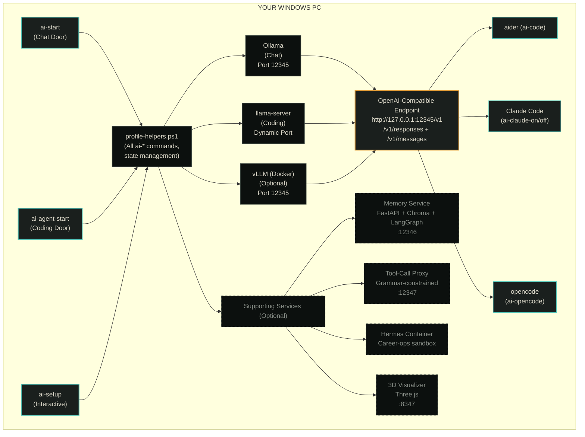

---

## Core Components

### 1. The Two Doors

```mermaid
flowchart LR
    subgraph CHAT["Chat Door"]
        AI_START["ai-start"]
        OLLAMA_C["Ollama / vLLM\nPort 12345"]
        MODEL_CHAT["Auto-picked model\nfor your VRAM"]
    end
    
    subgraph CODING["Coding Door"]
        AI_AGENT["ai-agent-start / ai-opencode"]
        UNSLOTH["Unsloth Dynamic 3.0\nHardware-sized quant"]
        GGUF["GGUF from HuggingFace\nByte-verified"]
        LLAMA_SRV["llama-server\nDynamic port"]
        CONTRACT["Live Pi 3/3 Contract\nMulti-turn coding test"]
        CERT["active-agent.json\n24h TTL"]
    end
    
    AI_START --> OLLAMA_C --> MODEL_CHAT
    AI_AGENT --> UNSLOTH --> GGUF --> LLAMA_SRV --> CONTRACT --> CERT
    
    style CHAT fill:#0c100e,stroke:#4fc3b8,stroke-width:2px
    style CODING fill:#0c100e,stroke:#e8a23c,stroke-width:2px
```

| Door | Entry Point | What It Does |
|------|-------------|--------------|
| **Chat** | `ai-start` | Starts Ollama or vLLM on port 12345. Single-instance, firewall-guarded, audit-logged. Auto-picks model for your VRAM. |
| **Coding** | `ai-agent-start` / `ai-opencode` | Sizes Unsloth Dynamic 3.0 to *your* free VRAM → downloads GGUF → starts llama-server → runs live Pi 3/3 contract → publishes certificate. |

**Why two doors?** Chat doesn't need tool-calling. Coding does. Mixing them means broken tool calls in chat or oversized models for coding. Two doors = honest capabilities.

### 2. The State Machine

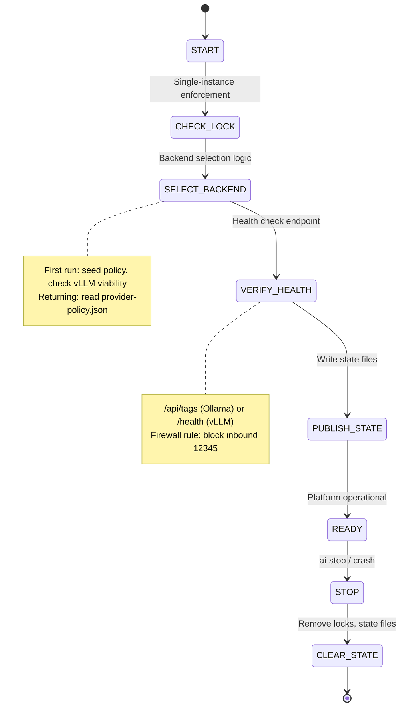

**State files** (in `~/.ai-platform/`):

| File | Purpose |
|------|---------|
| `.active-port.json` | Current port, model, start time |
| `state/active-provider.json` | Live truth: provider, model, endpoint, why |
| `state/active-agent.json` | Coding certificate (profile, model, expiry, fit state) |
| `config/policies/provider-policy.json` | Your intent: preferred backend, cloud fallback rules |
| `config/models.json` | Model registry (sizes, capabilities, verdicts) |

**Key principle:** `provider-policy.json` = your *intent*. `active-provider.json` = *live truth*. They're separate so a crashed session can't look like a changed preference.

### 3. Backend Selection Logic

```mermaid
flowchart TD
    AI_START["ai-start"] --> FIRST_RUN{"First run?"}
    
    FIRST_RUN -- Yes --> SEED_POLICY["Seed provider-policy.json"]
    SEED_POLICY --> CHECK_VLLM{"NVIDIA GPU\n+ Docker?"}
    
    CHECK_VLLM -- Yes --> ASK_BACKEND["Ask: Ollama or vLLM?"]
    ASK_BACKEND --> VLLM_CHOICE{"vLLM chosen?"}
    VLLM_CHOICE -- Yes --> VLLM_HEALTH["Health check vLLM"]
    VLLM_HEALTH -- Pass --> READY_VLLM["Ready: vLLM"]
    VLLM_HEALTH -- Fail --> FALLBACK_OLLAMA["Fallback to Ollama"]
    VLLM_CHOICE -- No --> READY_OLLAMA["Ready: Ollama"]
    
    CHECK_VLLM -- No --> READY_OLLAMA
    
    FIRST_RUN -- No --> READ_POLICY["Read provider-policy.json"]
    READ_POLICY --> VALID_BACKEND{"Valid backend\nstored?"}
    VALID_BACKEND -- Yes --> LAUNCH["Launch stored backend"]
    VALID_BACKEND -- No --> SEED_POLICY
    
    READY_VLLM --> READY["Platform Ready"]
    READY_OLLAMA --> READY
    FALLBACK_OLLAMA --> READY
    LAUNCH --> READY
    
    style AI_START fill:#1a1f1d,stroke:#4fc3b8
    style READY fill:#0c100e,stroke:#4fc3b8
```

### 4. The Coding Certificate Flow

```mermaid
flowchart TD
    AI_AGENT_START["ai-agent-start\n-DownloadConfirmed"]
    
    AI_AGENT_START --> LOCK["Lock (bootstrap.lock)"]
    LOCK --> RESOLVE_PROFILE["Resolve profile\nHardware-sized Unsloth quant"]
    RESOLVE_PROFILE --> DOWNLOAD_GGUF["Download GGUF\nHuggingFace → local cache\nByte-verified"]
    DOWNLOAD_GGUF --> START_LLAMA["Start llama-server\nGPU layers = free VRAM\n--jinja, --flash-attn"]
    START_LLAMA --> VERIFY_TEMPLATE["Verify template\nllama-server /props\nChat template check"]
    VERIFY_TEMPLATE --> MEMORY_CHECK{"Memory service\nhealthy?"}
    
    MEMORY_CHECK -- Yes --> START_EMBEDDING["Start embedding runtime"]
    START_EMBEDDING --> ROUTE_MEMORY["Route through\nmemory-service"]
    ROUTE_MEMORY --> RUN_CONTRACT
    MEMORY_CHECK -- No --> RUN_CONTRACT["Run Pi capability contract\nLive 3/3 multi-turn test"]
    
    RUN_CONTRACT --> FIT_GATE["Fit-state gate"]
    FIT_GATE --> ARTIFACT_FIT["ArtifactFit: model digest\nmatches downloaded GGUF"]
    FIT_GATE --> TRANSPORT_FIT["TransportFit: structured\ntool calls at wire"]
    FIT_GATE --> HARNESS_FIT["HarnessFit: Pi 3/3 PASS"]
    
    ARTIFACT_FIT --> ALL_PASS{"All gates\npass?"}
    TRANSPORT_FIT --> ALL_PASS
    HARNESS_FIT --> ALL_PASS
    
    ALL_PASS -- Yes --> PUBLISH_CERT["Publish active-agent.json\n24h TTL\nBound to: profile, model,\nharness, endpoint"]
    ALL_PASS -- No --> FAIL["FAIL: exact gate\nlogged + audit trail"]
    
    PUBLISH_CERT --> READY_CODING["Ready for:\nai-code / ai-claude-on /\nopencode / Pi"]
    
    style AI_AGENT_START fill:#1a1f1d,stroke:#e8a23c
    style PUBLISH_CERT fill:#0c100e,stroke:#4fc3b8
    style FAIL fill:#1a1f1d,stroke:#e0665a
```

**Why this matters:** No more "works on my machine." The certificate proves *this* model on *this* hardware passes *this* contract.

---

## Supporting Services

### Memory Service (Port 12346)

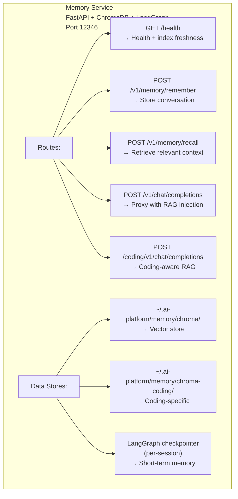

**Routing:** `ai-memory-on` rewrites `active-provider.json` endpoint to memory service. `ai-memory-off` restores direct backend.

### Tool-Call Proxy (Port 12347)

```mermaid
flowchart LR
    OLLAMA_NATIVE["Ollama /api/chat\n(native format)"] --> GRAMMAR["Grammar-constrained\nparser"]
    GRAMMAR --> OPENAI_FORMAT["OpenAI tool_calls\nformat"]
    
    style OLLAMA_NATIVE fill:#0c100e,stroke:#39433c
    style GRAMMAR fill:#1a1f1d,stroke:#e8a23c
    style OPENAI_FORMAT fill:#0c100e,stroke:#4fc3b8
```

Only for models that emit malformed tool calls. Not an agentic fix — just a translation layer. `ai-tool-proxy-start` / `ai-tool-proxy-stop`.

### Hermes Container

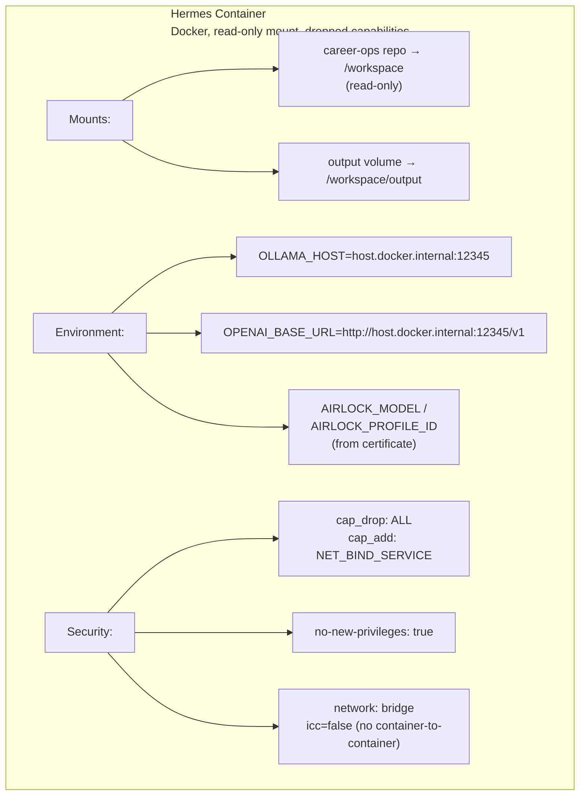

**Entry point:** `run-hermes.ps1` validates `active-agent.json` first. No cert = no launch.

### 3D Visualizer (Port 8347)

Standalone Three.js scene (`tools/3d-system-visualizer/index.html`). Reads audit logs → generates live scene → animates workflows. No build, no deps.

---

## Data Flow Examples

### Chat Request (`ai-start`)

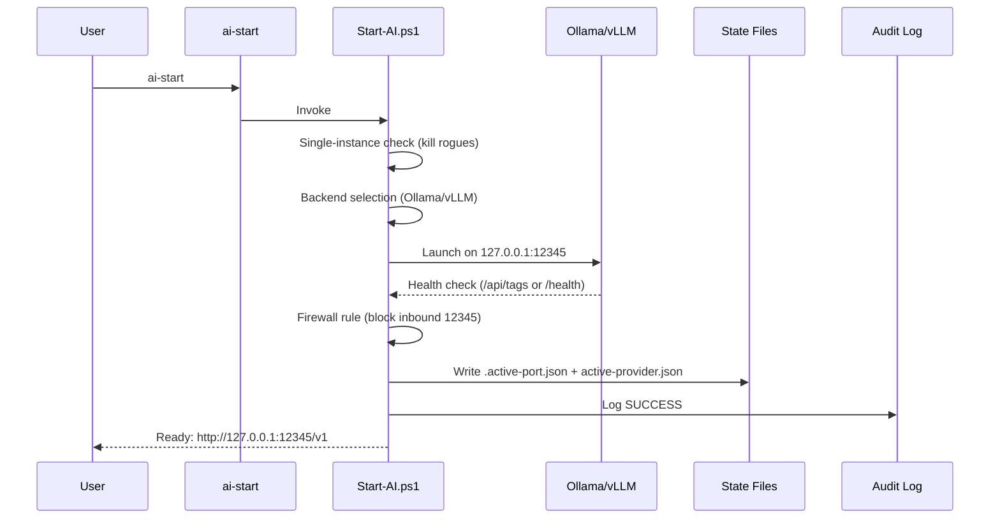

### Coding Session (`ai-agent-start`)

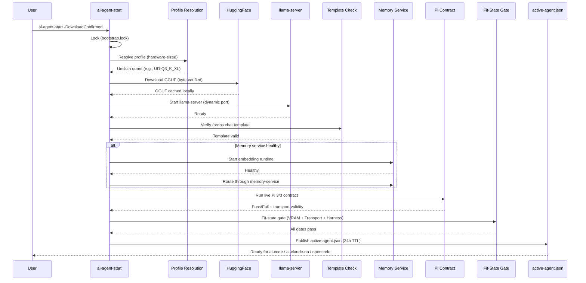

### Model Switch (`ai-switch`)

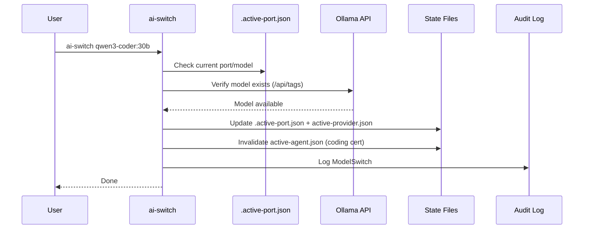

---

## Configuration Files

| File | Purpose | User-Editable? |
|------|---------|----------------|
| `config/models.json` | Model registry (sizes, caps, verdicts) | Yes |
| `config/policies/provider-policy.json` | Routing, cloud fallback, preferred models | Yes |
| `config/policies/commit-policy.json` | Pre-commit block patterns | Yes |
| `config/*.template` | Copy to remove `.template` suffix, fill in | Yes (copy first) |
| `~/.ai-platform/state/active-provider.json` | Live runtime state | **No** (platform-managed) |
| `~/.ai-platform/state/active-agent.json` | Coding certificate | **No** (platform-managed) |
| `~/.ai-platform/.active-port.json` | Current port/model | **No** (platform-managed) |

---

## Security Boundaries

```mermaid
flowchart TB
    subgraph HOST["HOST OS (Windows)"]
        NO_ACCESS["Desktop, Documents, Downloads → NO ACCESS"]
        NO_REPOS["Local code repos → NO ACCESS"]
        BLOCKED_LAN["LAN / other containers → BLOCKED (firewall)"]
        FULL_AI["~/.ai-platform/ → FULL ACCESS (platform owns this)"]
    end
    
    subgraph BACKENDS["LOCAL BACKENDS\n(Ollama / llama-server / vLLM)"]
        BIND["Bind: 127.0.0.1 ONLY (no 0.0.0.0)"]
        FIREWALL["Firewall: Inbound 12345 BLOCKED"]
        OLLAMA_CFG["Ollama: OLLAMA_NO_CLOUD=true\nOLLAMA_CONTEXT=32768"]
        VLLM_CFG["vLLM: --enable-auto-tool-choice"]
    end
    
    subgraph HERMES_CTN["HERMES CONTAINER"]
        RO_REPO["Read-only: career-ops repo"]
        OUT_ONLY["Volume: output only"]
        CAPS["Capabilities: DROP ALL\nadd NET_BIND_SERVICE"]
        NO_PRIV["no-new-privileges: true"]
        NET_ISO["Network: bridge, icc=false\n(no container-to-container)"]
        NO_HOST_FS["No host filesystem access"]
    end
    
    HOST --> BACKENDS
    BACKENDS --> HERMES_CTN
    
    style HOST fill:#0c100e,stroke:#39433c,stroke-width:2px
    style BACKENDS fill:#0c100e,stroke:#39433c,stroke-width:2px
    style HERMES_CTN fill:#1a1f1d,stroke:#e8a23c,stroke-width:2px
```

---

## Extension Points

| Extension | How |
|-----------|-----|
| New harness | Add to `ValidateSet` in `Start-AgentSession.ps1`, implement `Invoke-<Harness>CapabilityContract.ps1` |
| New runtime | Add to `Resolve-SessionEndpointMode`, create `runtime-adapters/<name>.ps1` |
| New model | Add to `config/models.json` with `agenticLoopVerdict` |
| New policy | Edit `config/policies/provider-policy.json` |
| New agent CLI | Add setup section to README + config template in `config/` |

---

## Key Design Decisions (ADR References)

| Decision | ADR | Why |
|----------|-----|-----|
| Two doors (chat vs coding) | ADR-016 | Tool-calling ≠ chat; mixing breaks both |
| Certificate-based coding | ADR-013, ADR-016 | Prove on *this* hardware, not trust |
| Separate policy vs live state | ADR-011 | Stale runtime ≠ changed intent |
| Hardware-sized Unsloth | ADR-018, ADR-005 | VRAM-first, mmap fallback, no inheritance |
| Fail-closed cloud | ADR-006 | Missing secrets = no cloud, not silent fallback |
| Certificate TTL = 24h | ADR-012 | Hardware changes, certs expire |
| Llama-server single port | ADR-012 §6.2 | No proxy split like Ollama; one route |

---

## File Ownership Map

| Directory | Owner | Modified By |
|-----------|-------|-------------|
| `scripts/` | Platform core | PR review required |
| `config/` | Platform + User | User edits templates; platform manages state |
| `docs/` | Documentation | Anyone |
| `hermes-container/` | Hermes team | PR review |
| `memory-service/` | Memory team | PR review |
| `tools/3d-system-visualizer/` | Viz team | PR review |
| `src/extension.ts` | VS Code team | PR review |
| `~/.ai-platform/state/` | Platform only | **Never** user-edit |
| `~/.ai-platform/config/` | User | User edits copied templates |

---

*This document describes the architecture as implemented. If reality differs from this doc, reality wins — update the doc.*