# Airlock Vision, Mission & Goals

```mermaid
flowchart TB
    subgraph VISION["VISION"]
        V["Every developer deserves a local AI\nthat works on THEIR hardware,\nnot someone else's"]
    end
    
    subgraph MISSION["MISSION\nBuild the most reliable, transparent\nlocal AI platform for Windows"]
        M1["Respects your hardware\nSizes models to YOUR VRAM/RAM"]
        M2["Earns your trust\nProves tool-calling on YOUR machine"]
        M3["Stays out of your way\nTwo commands: ai-start, ai-agent-start"]
        M4["Tells the truth\nNo hidden failures"]
    end
    
    subgraph USER_GOALS["USER GOALS"]
        UG1["Zero-config startup\nai-start works everywhere"]
        UG2["Honest capabilities\nNo pretending on weak hardware"]
        UG3["Portable skills\nLaptop → Workstation → DGX"]
        UG4["No vendor lock-in\nYour models, data, hardware"]
    end
    
    subgraph PLATFORM_GOALS["PLATFORM GOALS"]
        PG1["Single source of truth\nOne endpoint, one config, one log"]
        PG2["Fail closed\nNo silent fallbacks, no surprise bills"]
        PG3["Observable by default\nEvery call logged, every state audited"]
        PG4["Extensible without chaos\nNew harnesses/runtimes/models via contract"]
    end
    
    V --> M1
    V --> M2
    V --> M3
    V --> M4
    
    M1 --> UG1
    M1 --> UG3
    M2 --> UG2
    M2 --> UG4
    M3 --> UG1
    M4 --> UG2
    M4 --> UG4
    
    M1 --> PG1
    M2 --> PG3
    M3 --> PG1
    M4 --> PG2
    M4 --> PG3
    
    style V fill:#0c100e,stroke:#e8a23c,stroke-width:3px
    style MISSION fill:#0c100e,stroke:#4fc3b8,stroke-width:2px
    style USER_GOALS fill:#1a1f1d,stroke:#4fc3b8
    style PLATFORM_GOALS fill:#1a1f1d,stroke:#e8a23c
```

---

## Vision

**Every developer deserves a local AI that works on their hardware, not someone else's.**

Airlock exists because running local AI shouldn't require a PhD in infrastructure. You shouldn't need to know which port Ollama is on, whether your firewall is open, or why your model keeps OOM'ing. The platform handles the complexity so you can focus on building.

## Mission

Build the most reliable, transparent local AI platform for Windows — one that:

1. **Respects your hardware** — Sizes models to *your* VRAM/RAM, not a spec sheet
2. **Earns your trust** — Proves tool-calling works on *your* machine before you use it
3. **Stays out of your way** — Two commands (`ai-start`, `ai-agent-start`). That's it.
4. **Tells the truth** — When something doesn't work, it says so. No hidden failures.

## Goals

### For Users
- **Zero-config startup** — `ai-start` works on any Windows 11 machine with zero manual config
- **Honest capabilities** — If a model can't do agentic coding on your hardware, Airlock won't pretend it can
- **Portable skills** — What you learn on your laptop works on your workstation, your DGX, your cloud VM
- **No vendor lock-in** — Your models, your data, your hardware. Airlock just manages the plumbing.

### For the Platform
- **Single source of truth** — One endpoint (`127.0.0.1:12345/v1`), one config, one audit log
- **Fail closed** — No silent fallbacks, no hidden cloud calls, no surprise bills
- **Observable by default** — Every API call logged, every state change audited
- **Extensible without chaos** — New harnesses, new runtimes, new models — all through the same contract

## What "Done" Looks Like

| Milestone | Status | Notes |
|-----------|--------|-------|
| Chat door (`ai-start`) works on any Windows 11 | ✅ | Single-instance, firewall, auto-model |
| Coding door (`ai-agent-start`) proves tool-calling | ✅ | Hardware-sized Unsloth + live Pi 3/3 |
| Multiple harness support | ✅ | Pi, opencode, aider, openclaw |
| Cross-harness session resume | ✅ | Works across Claude, Grok, Pi, OpenCode |
| Hermes sandboxed agent | ✅ | Containerized, read-only career-ops repo |
| Memory service (RAG + sessions) | ✅ | FastAPI + Chroma + LangGraph |
| vLLM backend option | ✅ | With `--enable-auto-tool-choice` |
| Tool-call proxy | ✅ | Grammar-constrained fallback |

## What's Still Honest

| Gap | Why It's Not Hidden |
|-----|---------------------|
| Ollama tool-calling fails agentic loops | Documented in ADR-012, ADR-014, models.json |
| vLLM tool-calling untested on this hardware | Marked `local-limited` in config, needs GPU |
| Linux port unverified | Spec exists, no Ubuntu test run yet |
| Embedding runtime needs live validation | PENDING-9, implemented but untested |
| Chat door auto-select ignores agentic verdict | ADR-012 AGENT-001, flagged in README |

## Non-Goals

- **Cloud-first** — Airlock is local-first. Cloud is opt-in, gated, audited.
- **Model zoo** — We curate a small, verified set. Not 500 models.
- **GUI dashboard** — CLI first. VS Code extension is a thin wrapper.
- **Multi-user** — Single-user, single-machine. By design.

## Philosophy

> **Complexity belongs in the platform, not in the user's workflow.**

Every design decision in Airlock starts with: *What would make this simpler for the person typing `ai-start`?* If it adds a config file, a manual step, or a "read the docs first" moment, it's probably wrong.

---

*This document is the north star. Every PR should move us closer to it.*